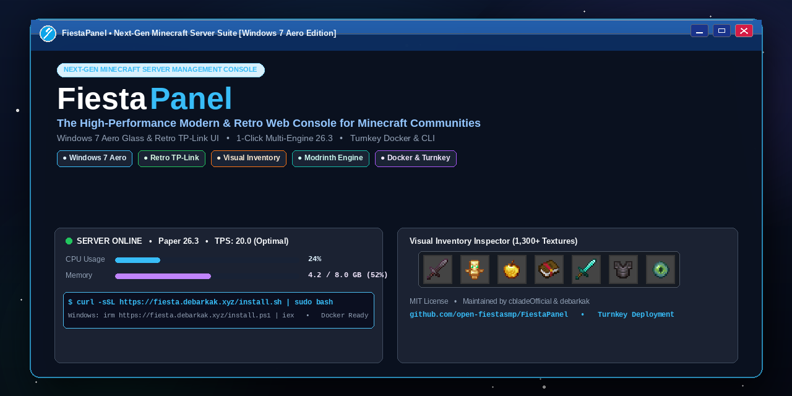

<p align="center">
  
</p>

<h1 align="center">🌐 FiestaPanel</h1>

<p align="center">
  <strong>The Modern & Retro Minecraft Server Management Suite</strong><br>
  Nostalgic TP-Link & Windows 7 Aero Aesthetics • Real-Time Telemetry • Visual Inventory Inspector • Modrinth Plugin Manager • Jailed File Manager • Turnkey Deployment
</p>

<p align="center">
  <a href="LICENSE"></a>
  <a href="https://python.org"></a>
  
  
</p>

---


## ⚡ Quick Start

### 🐧 Linux & 🍎 macOS (1-Line Install)
```bash
curl -sSL https://fiesta.debarkak.xyz/install.sh | sudo bash
```
*(Or from GitHub: `curl -sSL https://raw.githubusercontent.com/open-fiestasmp/FiestaPanel/main/install.sh | bash`)*

### 🪟 Windows 10 / 11 / Server (1-Line PowerShell Install)
Open PowerShell (as regular user or Administrator) and run:
```powershell
irm https://fiesta.debarkak.xyz/install.ps1 | iex
```
*(Or from GitHub: `irm https://raw.githubusercontent.com/open-fiestasmp/FiestaPanel/main/install.ps1 | iex`)*  
*(From Windows Command Prompt (CMD): `powershell -ExecutionPolicy Bypass -Command "irm https://fiesta.debarkak.xyz/install.ps1 | iex"`)*  
*(Manual install: Clone repo and run `install.bat` or double-click `start.bat`)*

> [!NOTE]
> **No Pre-installed Server Required**: You do not need to install Minecraft beforehand. You can install and launch **Paper, Purpur, Fabric, Spigot, or Vanilla** in 1-click directly from the web panel without opening SSH or terminal!

---

## 📚 Documentation Index

| Guide | Description |
|---|---|
| 🚀 [**Installation Guide**](INSTALL.md) | Complete step-by-step setup, 1-line Windows/Linux/macOS installers, systemd, and Nginx SSL setup |
| 🏗️ [**Architecture & Design**](docs/ARCHITECTURE.md) | Deep-dive into process model, daemon control, texture atlas, and data flow |
| 🌟 [**Feature Tour**](docs/FEATURES.md) | Exhaustive guide covering console, inventory inspector, Modrinth, world controls, etc. |
| 📡 [**REST API Reference**](docs/API.md) | Full JSON API specification for headless integrations and automation |
| 🛡️ [**Security & Best Practices**](docs/SECURITY.md) | PBKDF2 hashing, path traversal defenses, role-based access control, firewall setup |

---

## ✨ Features at a Glance

| Feature | Highlights |
|---|---|
| 🎮 **Full Process Control** | Start, stop, restart, and tail live ANSI logs with top/bottom scroll navigation. |
| 🎒 **Visual Inventory Inspector** | Real-time armor, offhand, storage & hotbar viewer with authentic 1.21 item textures and giving search tool. |
| 🔌 **Addons (Plugins & Mods) Engine** | Context-aware manager for Bukkit/Spigot/Paper plugins and Fabric/Forge/NeoForge mods with 1-click Modrinth directory installation. |
| 📁 **Jailed File Manager** | In-browser code & config editor, directory navigation, and drag-and-drop file uploads with traversal protection. |
| 🌍 **World & Weather Controls** | Day/Noon/Night cycles, weather clear/rain/thunder toggles, and safe world flushing (`/save-all`). |
| 👥 **Sub-Users & Access Control** | Multi-user roles (Admin, Operator, Viewer) with salted PBKDF2 password hashing. |
| 🎨 **Windows 7 Aero & Retro Themes** | Authentic 7.css specular glass reflection, TP-Link legacy, Windows 98, Dark Mode, Matrix, and Cyberpunk. |
| 🏷️ **Complete Brand Customization** | Header icon picker (12 themed presets + local file upload + custom URL/SVG), custom title, hardware model number, and tagline. |

---

## 🧰 The `panelctl` CLI

FiestaPanel installs a system management CLI accessible anywhere:

```bash
panelctl status        # Check daemon health and memory usage
panelctl restart       # Gracefully restart FiestaPanel
panelctl logs          # Tail live systemd journal logs
panelctl reset-admin   # Interactively reset or generate admin password
panelctl set-port 8080 # Update HTTP listener port
panelctl set-mc-path   # Switch managed Minecraft server path
panelctl info          # Print configuration overview
panelctl version       # FiestaPanel Software Suite v2.0.0
```

---

## 🖼️ Themes Supported

- **Windows 7 Aero**: Authentic design powered by [**7.css**](https://github.com/khang-nd/7.css) by Khang NT. Vibrant electric azure Aero Glass frames, specular glass reflection buttons, interactive titlebar controls (minimize/maximize/close), and Segoe UI typography.
- **TP-Link Classic**: Retro 2000s router web interface.
- **Windows 98**: Classic desktop bevels and teal aesthetic.
- **Dark Mode**: High contrast OLED dark styling.
- **Cyberpunk**: Neon cyan and magenta terminal aesthetics.
- **Matrix**: Phosphor green CRT monitor glow.

---

## 🙏 Acknowledgements & Credits

- [**7.css**](https://github.com/khang-nd/7.css) by **Khang NT** ([@khang-nd](https://github.com/khang-nd)) — Powers the authentic Windows 7 Aero Glass styling, glossy specular highlights, and window control buttons (MIT License).
- [**Modrinth API**](https://modrinth.com) — Powers the built-in online Mod & Plugin search engine and 1-click installations.
- [**PaperMC API**](https://papermc.io) — Real-time upstream server software version detection and binary downloads.

---

## 📄 License

This project is licensed under the [MIT License](LICENSE).  
Copyright (c) 2026 FiestaPanel Contributors & Fiesta Team.
