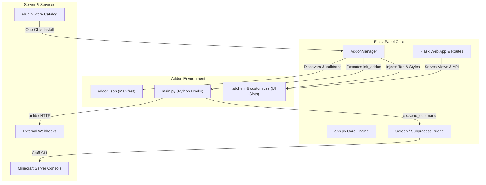

# FiestaPanel Web Panel Addon Developer Guide

Welcome to the **FiestaPanel Addon & Plugin Extension Guide**!  
FiestaPanel features a modular, event-driven web panel addon system that allows server administrators and developers to extend the web interface, register custom navigation views, automate server routines, inject custom themes and styles, and integrate external services (such as Discord, Dynmap, and Cloud Backups).

---

## Table of Contents
1. [Architecture Overview](#-architecture-overview)
2. [Addon Folder Structure](#-addon-folder-structure)
3. [The `addon.json` Manifest](#-the-addonjson-manifest)
4. [Backend Python Module (`main.py`)](#-backend-python-module-mainpy)
5. [Frontend UI Slots & Templates (`tab.html`)](#-frontend-ui-slots--templates-tabhtml)
6. [Step-by-Step Tutorial: Building Your First Addon](#-step-by-step-tutorial-building-your-first-addon)
7. [In-Panel Addon Store Integration](#-in-panel-addon-store-integration)
8. [Packaging & Distribution](#-packaging--distribution)
9. [REST API Reference](#-rest-api-reference)

---

##  Architecture Overview

FiestaPanel addons run within the panel process and seamlessly interface with both the Flask web server and the underlying Minecraft server session.



### Key Capabilities:
- **Navigation Tabs**: Add custom views into the sidebar navigation across all themes (Windows 7 Aero, Classic TP-Link, Dark, etc.).
- **Server Command Execution**: Run Minecraft console commands directly with `ctx.send_command("say Hello!")`.
- **Server Telemetry Access**: Read live TPS, online player lists, and server status via `ctx.get_server_status()`.
- **Custom Configuration**: Define form fields in `settings_schema` and persist settings with automatic JSON serialization.
- **REST Actions**: Handle frontend AJAX requests with `on_action(ctx, action_name, payload)`.

---

## Addon Folder Structure

Addons reside in the `addons/` directory (e.g. `/opt/fiestapanel/addons/<addon_id>/` or `./addons/<addon_id>/`):

```text
addons/
└── my_custom_addon/
    ├── addon.json        # Required: Addon metadata, schema, and UI slot configuration
    ├── main.py           # Optional: Backend Python execution hooks and action handlers
    ├── tab.html          # Optional: Custom HTML template rendered inside the panel view
    ├── custom.css        # Optional: Custom CSS stylesheet injected into the page DOM
    ├── custom.js         # Optional: Frontend JavaScript behavior
    └── README.md         # Documentation and instructions
```

---

## The `addon.json` Manifest

Every addon **must** contain an `addon.json` file in its root directory. Here is a complete reference:

```json
{
  "id": "my_announcer",
  "name": "Server Auto-Announcer",
  "version": "1.0.0",
  "author": "YourName",
  "description": "Periodically broadcasts custom announcement messages to all players in-game.",
  "icon": "fas fa-bullhorn",
  "category": "Automation",
  "enabled": true,
  "entrypoint": "main.py",
  "settings_schema": [
    {
      "key": "message_text",
      "label": "Announcement Text",
      "type": "text",
      "default": "§e✦ Visit our server shop at store.example.com! ✦",
      "placeholder": "Enter broadcast message..."
    },
    {
      "key": "broadcast_interval",
      "label": "Interval (Minutes)",
      "type": "number",
      "default": 15
    },
    {
      "key": "enable_sound",
      "label": "Play Chime Sound to Players",
      "type": "checkbox",
      "default": true
    }
  ],
  "default_settings": {
    "message_text": "§e✦ Visit our server shop at store.example.com! ✦",
    "broadcast_interval": 15,
    "enable_sound": true
  },
  "ui_slots": {
    "tab": {
      "title": "Announcer",
      "icon": "fas fa-bullhorn",
      "description": "Configure automated announcements and test live chat broadcasts."
    }
  }
}
```

### Supported Manifest Categories:
- `Integration`: Discord, Slack, external webhooks, Dynmap, BlueMap.
- `Automation`: Schedulers, automated restarts, auto-save routines.
- `Tools`: MOTD stylers, RCON consoles, inventory calculators.
- `Visuals`: Live web maps, camera feeds, dynamic charts.
- `Administration`: Maintenance gates, auto-moderation, whitelist gates.
- `Customization`: Themes, custom stylesheets, header icons.

---

## Backend Python Module (`main.py`)

If specified by the `"entrypoint"` property, FiestaPanel will load your Python file and provide it with an `AddonContext`.

### 1. Initialization Hook (`init_addon`)
Called when FiestaPanel starts or when the addon is enabled:

```python
def init_addon(ctx):
    """
    Called upon addon initialization.
    :param ctx: AddonContext instance providing core APIs.
    """
    ctx.logger.info("Auto-Announcer addon has been loaded!")
```

### 2. Action Handler Hook (`on_action`)
Called when the frontend or API triggers `POST /api/panel-addons/<addon_id>/action`:

```python
def on_action(ctx, action_name, payload):
    """
    Dispatches custom actions from UI buttons or API requests.
    """
    if action_name == "broadcast_now":
        settings = ctx.get_settings()
        msg = payload.get("message") or settings.get("message_text", "Default Announcement")
        
        # Send Minecraft command
        success, response = ctx.send_command(f"say {msg}")
        
        if settings.get("enable_sound", True):
            ctx.send_command("playsound minecraft:entity.experience_orb.pickup master @a")
            
        return {
            "success": success,
            "message": "Broadcast sent to all online players!" if success else response
        }
        
    return {"success": False, "error": f"Unknown action: {action_name}"}
```

### 3. AddonContext API Reference
| Method / Attribute | Description |
| :--- | :--- |
| `ctx.addon_id` | String ID of the addon. |
| `ctx.addon_dir` | Absolute filesystem path to the addon folder. |
| `ctx.logger` | Dedicated Python logger (`fiestapanel.addon.<id>`). |
| `ctx.get_settings()` | Returns `dict` of current addon settings. |
| `ctx.save_settings(dict)` | Persists updated settings to `addon.json`. |
| `ctx.send_command(cmd)` | Sends command to Minecraft console (`returns (bool, msg)`). |
| `ctx.get_server_status()` | Queries server ping, TPS, and player sample. |
| `ctx.register_hook(event, fn)`| Registers callback for system events. |

---

##  Frontend UI Slots & Templates (`tab.html`)

When `"ui_slots": { "tab": { ... } }` is defined, FiestaPanel automatically adds your addon into the navigation bar and renders `tab.html` in the center workspace.

### Example `tab.html`:
```html
<div class="panel-box">
  <div class="section-title-bar">
    <span>Server Auto-Announcer</span>
    <span class="inline-badge" style="background:#0088cc;color:#fff;">Active Addon</span>
  </div>
  <p class="inline-hint">
    Broadcast announcements to all connected players directly from FiestaPanel.
  </p>

  <table class="form-layout-table">
    <tr>
      <td class="label-col">Message to Broadcast:</td>
      <td class="val-col">
        <input type="text" id="my-addon-msg" class="ctrl-input" style="width:75%;" 
               placeholder="Enter announcement text...">
        <button class="btn-classic" style="font-weight:bold;margin-left:6px;" onclick="sendAnnouncementNow()">
          [ Broadcast Now ]
        </button>
      </td>
    </tr>
  </table>

  <div id="announcement-feedback" style="margin-top:12px;font-weight:bold;"></div>
</div>

<script>
function sendAnnouncementNow() {
  const msg = document.getElementById('my-addon-msg').value;
  const feedback = document.getElementById('announcement-feedback');
  feedback.textContent = 'Sending...';

  fetch('/api/panel-addons/my_announcer/action', {
    method: 'POST',
    headers: { 'Content-Type': 'application/json' },
    body: JSON.stringify({
      action: 'broadcast_now',
      payload: { message: msg }
    })
  })
  .then(res => res.json())
  .then(data => {
    if (data.success) {
      feedback.style.color = '#00aa00';
      feedback.textContent = '✓ ' + data.message;
    } else {
      feedback.style.color = '#cc0000';
      feedback.textContent = '✗ ' + (data.error || 'Failed to send');
    }
  })
  .catch(err => {
    feedback.style.color = '#cc0000';
    feedback.textContent = 'Network error: ' + err;
  });
}
</script>
```

---

## Step-by-Step Tutorial: Building Your First Addon

### Step 1: Create the Addon Directory
In your FiestaPanel directory, create a new folder:
```bash
mkdir -p addons/quick_heal
cd addons/quick_heal
```

### Step 2: Write `addon.json`
```json
{
  "id": "quick_heal",
  "name": "Quick Heal & Feed Utility",
  "version": "1.0.0",
  "author": "YourName",
  "description": "One-click button to heal and replenish hunger for all online players.",
  "icon": "fas fa-heart",
  "category": "Tools",
  "enabled": true,
  "entrypoint": "main.py",
  "ui_slots": {
    "tab": {
      "title": "Quick Heal",
      "icon": "fas fa-heart",
      "description": "Instant player vitality restoration"
    }
  }
}
```

### Step 3: Write `main.py`
```python
def init_addon(ctx):
    ctx.logger.info("Quick Heal addon loaded!")

def on_action(ctx, action_name, payload):
    if action_name == "heal_all":
        ctx.send_command("effect give @a minecraft:instant_health 1 255 true")
        ctx.send_command("effect give @a minecraft:saturation 1 255 true")
        ctx.send_command("say §a[HEALTH] All players have been healed and fed!")
        return {"success": True, "message": "All players healed and fed!"}
    return {"success": False, "error": "Unknown action"}
```

### Step 4: Write `tab.html`
```html
<div class="panel-box">
  <div class="section-title-bar"><span>Quick Heal &amp; Feed</span></div>
  <p class="inline-hint">Instantly restores health and hunger bars for all currently connected members.</p>
  <button class="btn-classic" style="padding:6px 20px;font-weight:bold;color:#008800;" onclick="triggerQuickHeal()">
    [ ❤ Heal &amp; Feed All Players ]
  </button>
  <div id="heal-result" style="margin-top:10px;font-weight:bold;"></div>
</div>

<script>
function triggerQuickHeal() {
  fetch('/api/panel-addons/quick_heal/action', {
    method: 'POST',
    headers: {'Content-Type': 'application/json'},
    body: JSON.stringify({ action: 'heal_all', payload: {} })
  })
  .then(r => r.json())
  .then(d => {
    document.getElementById('heal-result').textContent = d.message || d.error;
  });
}
</script>
```

### Step 5: Reload FiestaPanel
Navigate to **Panel Addons & Extensions -> Installed Addons** in the panel. Click **Reload Addons**, and your **Quick Heal** tab will immediately appear in the sidebar!

---

## In-Panel Addon Store Integration

FiestaPanel includes an integrated **Plugin Store** (`/api/panel-addons/store`) featuring One-Click installation:
- **Discord Alerts & Webhook Bridge**: Real-time Discord integration.
- **Dynmap & BlueMap Live Map Viewer**: Interactive 2D/3D map embed.
- **Automated Server Scheduler & Cron**: Scheduled reboots, commands, and backups.
- **Minecraft MOTD Gradient & MiniMessage Styler**: RGB hex color gradient designer.
- **Server Maintenance Gate & Auto-Lock**: Emergency maintenance mode switch.
- **Panel Theme Customizer & Custom CSS Studio**: DOM style injector and wallpaper manager.

To submit your community addon to the official catalog:
1. Export or package your addon files as a `.zip` bundle (`addon.json`, `main.py`, `tab.html`, `README.md`).
2. Submit your `.zip` bundle via a Pull Request to [`https://github.com/open-fiestasmp/FiestaPanel`](https://github.com/open-fiestasmp/FiestaPanel) or send it to the Fiesta team on our Discord server.
3. The **FiestaSMP core team will review, security-audit, test, and approve the sent .zip file**.
4. Once approved, the team publishes your addon to the official store catalog, making it available for One-Click install across all installations worldwide!

---

## Packaging & Distribution

To share your addon with others:
1. Ensure all files (`addon.json`, `main.py`, `tab.html`) are in the root of your zip file (or inside a single root folder).
2. Zip the contents:
   ```bash
   zip -r my_addon.zip addon.json main.py tab.html README.md
   ```
3. Users can install it directly by uploading the `.zip` file under **Panel Addons -> Upload Package (.zip)** or by pasting a direct URL!

---

## REST API Reference

All addon management endpoints require administrator authentication:

| Endpoint | Method | Description |
| :--- | :--- | :--- |
| `/api/panel-addons` | `GET` | List all installed addons with manifest & settings. |
| `/api/panel-addons/<id>/toggle` | `POST` | Enable or disable an addon (`{"enabled": true/false}`). |
| `/api/panel-addons/<id>/settings` | `POST` | Save updated addon settings (`{"settings": {...}}`). |
| `/api/panel-addons/<id>/uninstall` | `POST` | Delete the addon folder from disk. |
| `/api/panel-addons/<id>/action` | `POST` | Execute custom backend action (`{"action": "...", "payload": {...}}`). |
| `/api/panel-addons/<id>/view` | `GET` | Render the HTML tab view for this addon. |
| `/api/panel-addons/store` | `GET` | Fetch the full Plugin Store catalog with install status. |
| `/api/panel-addons/store/install` | `POST` | One-Click install an addon from the store (`{"addon_id": "..."}`). |
| `/api/panel-addons/upload` | `POST` | Upload and unpack an addon `.zip` archive. |
| `/api/panel-addons/install-url` | `POST` | Download and install an addon from a ZIP URL (`{"url": "..."}`). |
| `/api/panel-addons/template/download` | `GET` | Download starter boilerplate zip package for developers. |
